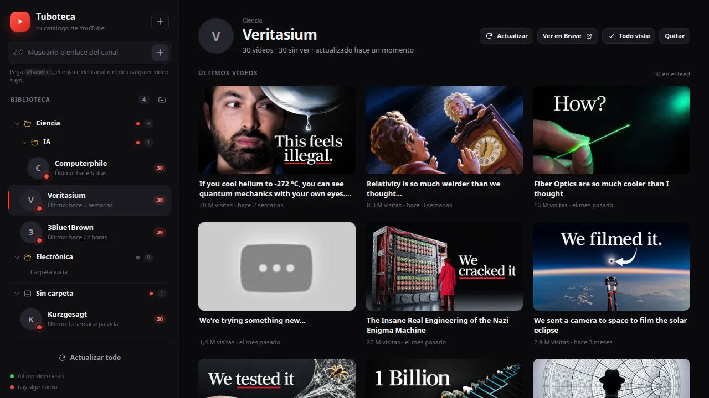

# Tuboteca

> Un catálogo local de canales y videos con carpetas anidadas, estados visto/no visto y un reproductor que no depende de la API oficial.



**Software & IA · biblioteca personal** · **0** dependencias · **3** estados · **10 min** caché · **1** servidor

## Qué es

Tuboteca: servidor Node sin dependencias, árbol de canales, caché de feed y una interfaz de escritorio para ordenar lo que ves.

El repositorio incluye canales de demostración. Tus suscripciones e historiales reales no se publican.

## El problema

### Suscribirse no es organizar.

YouTube guarda canales, pero no te dice qué viste, qué te falta ni cómo agruparlo según tu criterio.

- La lista de suscripciones crece y se vuelve un flujo infinito. Los videos importantes se pierden entre recomendaciones. Y no hay una forma simple de crear carpetas propias, anidadas, con estados de lectura.
- Tuboteca propone un escritorio local: un servidor Node que lee los canales que tú eliges, guarda un árbol de carpetas y recuerda qué videos ya viste.
- No usa la API oficial ni requiere una clave. Lee la página pública del canal, extrae `ytInitialData` y, si cambia, intenta la API interna de YouTube como respaldo.

## Cómo funciona

### Canales, videos y tres estados.

El servidor hace el trabajo pesado; la interfaz solo muestra el árbol y recuerda el estado.

1. **Agregar** — Acepta un handle, una URL de canal o un video; resuelve el ID y guarda el canal.
2. **Leer el feed** — Descarga la página pública, extrae `ytInitialData` y recorre los videos publicados.
3. **Parsear** — Convierte la estructura de YouTube en una lista plana de videos con título, fecha e ID.
4. **Cachear** — Guarda el resultado durante 10 minutos y conserva una copia stale si la red falla.
5. **Marcar** — El estado visto/no visto se guarda por video y se refleja en el punto de cada canal.

## Arquitectura

### Un servidor pequeño, una interfaz de escritorio.

Node sin dependencias mantiene el estado; el navegador solo pinta y envía acciones.

`Navegador` (public/) → `Node HTTP` (server.js) → `YouTube` (HTML público) → `Estado` (JSON)

- **Sin API oficial**: No hay OAuth ni cuota. Se lee la página pública y se usa Innertube como respaldo.
- **Caché con stale**: Si YouTube no responde, se muestra la última copia válida en vez de una pantalla vacía.
- **Escritorio propio**: Carpetas anidadas, arrastrar canales y estados por video.

## Capturas


*Biblioteca con canales demo, árbol de carpetas y panel de videos.*

## Stack

Node.js, http, fs, JavaScript, HTML/CSS.

El servidor usa únicamente módulos nativos de Node: `http`, `fs`, `path` y `url`. No hay `npm install`. El frontend es JavaScript vanilla y CSS propio. El estado se guarda en JSON y se escribe con `rename` atómico para evitar corrupciones.

## Instalación rápida

```bash
# Sin dependencias: solo Node.js 18+
PORT=4321 node server.js
# Abrir http://127.0.0.1:4321
```

## Estructura del repositorio

```text
tuboteca/
├── server.js            # servidor HTTP sin dependencias
├── public/              # interfaz de escritorio
├── data/                # datos demo (canales y árbol)
├── docs/                # página, datasheet y developer
├── start.sh
└── README.md
```

## Límites y decisiones

- **Sin API oficial**: Depende del HTML público de YouTube. Si cambia, el parser puede necesitar ajustes.
- **Datos demo**: Los canales incluidos son públicos y sirven de ejemplo; no son suscripciones personales.
- **Sin descargas**: Reproduce con el reproductor nocookie; no descarga videos.
- **Un usuario**: No hay multiusuario ni autenticación: es una biblioteca local.

## Preguntas frecuentes

**¿Necesito una API key?**

No. La app lee la página pública y usa la API interna como respaldo.

**¿Dónde se guardan mis canales?**

En `data/channels.json`, local. El repo publica una versión demo.

**¿Qué pasa si YouTube cambia?**

El parser puede fallar; la caché stale mantiene la última lista disponible.

**¿Puedo crear carpetas?**

Sí, el árbol permite anidar carpetas y mover canales.


## Seguridad

El repo publica `data/channels.json` con canales demo, no suscripciones reales. La clave de respaldo de Innertube se reemplazó por `x`; la app lee la clave pública desde la página de YouTube y solo usa el fallback si el HTML cambia.


## Documentación

- [Datasheet](docs/datasheet.md): qué hace, cómo se usa y qué límites tiene.
- [Developer](docs/developer.md): arquitectura, archivos y puntos de extensión.
- [Página del proyecto](https://jmadasme.github.io/tuboteca/): capturas, video y guía visual.

## Seguridad y datos

El repo publica `data/channels.json` con canales demo, no suscripciones reales. La clave de respaldo de Innertube se reemplazó por `x`; la app lee la clave pública desde la página de YouTube y solo usa el fallback si el HTML cambia.

Las claves, tokens y contraseñas de ejemplo se publican como `x`. Si vas a desplegar el proyecto, creá tus propios secretos y no los subas al repositorio.

## Licencia

MIT © jmadasme. El código se comparte para estudio y reutilización; los datos de terceros conservan sus propias licencias.
