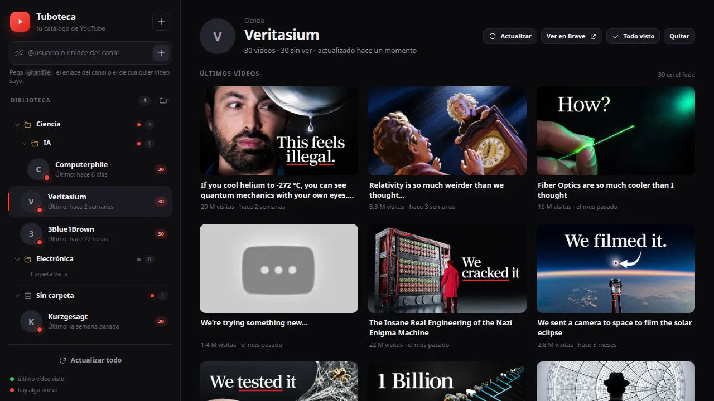

# Tuboteca · datasheet

**Software & IA · biblioteca personal**

Tuboteca — Un catálogo local de canales y videos con carpetas anidadas, estados visto/no visto y un reproductor que no depende de la API oficial.

## Ficha

| Métrica | Valor |
|---|---|
| 0 | dependencias |
| 3 | estados |
| 10 min | caché |
| 1 | servidor |

## Qué resuelve

YouTube guarda canales, pero no te dice qué viste, qué te falta ni cómo agruparlo según tu criterio.

## Cómo se opera

1. **Agregar un canal** — Pegá un @handle, una URL de canal o un video; la app resuelve el ID.
2. **Ordenar** — Arrastrá canales a carpetas anidadas.
3. **Ver estado** — El punto verde/rojo indica si hay videos nuevos desde la última visita.
4. **Reproducir** — El reproductor usa youtube-nocookie y conserva el estado visto/no visto.

## Flujo técnico

| Etapa | Qué ocurre |
|---|---|
| Agregar | Acepta un handle, una URL de canal o un video; resuelve el ID y guarda el canal. |
| Leer el feed | Descarga la página pública, extrae `ytInitialData` y recorre los videos publicados. |
| Parsear | Convierte la estructura de YouTube en una lista plana de videos con título, fecha e ID. |
| Cachear | Guarda el resultado durante 10 minutos y conserva una copia stale si la red falla. |
| Marcar | El estado visto/no visto se guarda por video y se refleja en el punto de cada canal. |

## Capturas

*Biblioteca con canales demo, árbol de carpetas y panel de videos.*

## Límites

| Límite | Detalle |
|---|---|
| Sin API oficial | Depende del HTML público de YouTube. Si cambia, el parser puede necesitar ajustes. |
| Datos demo | Los canales incluidos son públicos y sirven de ejemplo; no son suscripciones personales. |
| Sin descargas | Reproduce con el reproductor nocookie; no descarga videos. |
| Un usuario | No hay multiusuario ni autenticación: es una biblioteca local. |

## Preguntas frecuentes

**¿Necesito una API key?**

No. La app lee la página pública y usa la API interna como respaldo.

**¿Dónde se guardan mis canales?**

En `data/channels.json`, local. El repo publica una versión demo.

**¿Qué pasa si YouTube cambia?**

El parser puede fallar; la caché stale mantiene la última lista disponible.

**¿Puedo crear carpetas?**

Sí, el árbol permite anidar carpetas y mover canales.

## Seguridad

El repo publica `data/channels.json` con canales demo, no suscripciones reales. La clave de respaldo de Innertube se reemplazó por `x`; la app lee la clave pública desde la página de YouTube y solo usa el fallback si el HTML cambia.

## Enlaces

- [README](../README.md)
- [Developer](developer.md)
- [Página del proyecto](https://jmadasme.github.io/tuboteca/)
